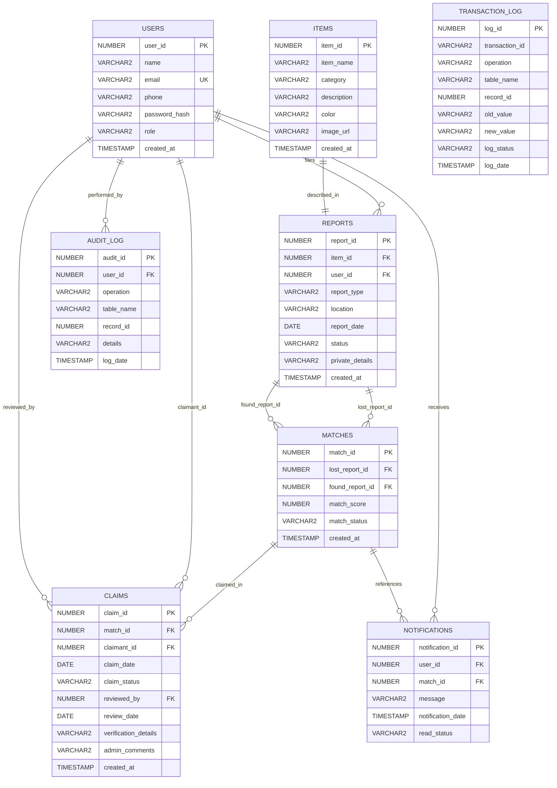

# FindIt – Entity-Relationship (ER) Diagram & Specification

## 1. Overview
The **FindIt – Campus Lost & Found Management System** database is designed to enforce relational integrity, privacy, automated match discovery, and strict administrative accountability across all item lifecycle events.

---

## 2. Mermaid Entity-Relationship Diagram

---

## 3. Entity Definitions & Structural Constraints

### A. USERS
- **Description**: Stores user accounts for both Students and System Administrators.
- **Key Attributes**:
  - `user_id` (Primary Key, generated by `SEQ_USERS`)
  - `email` (Candidate Key, Unique, validated format)
  - `role` (Check constraint: `role IN ('STUDENT', 'ADMIN')`)
- **Cardinality**:
  - 1 User to N Reports (A user can report 0, 1, or many lost/found items).
  - 1 User to N Claims (A student can file 0, 1, or many claims).
  - 1 User to N Notifications.

### B. ITEMS
- **Description**: Catalogs physical properties of items independently of the reporting event.
- **Key Attributes**:
  - `item_id` (Primary Key, generated by `SEQ_ITEMS`)
  - `category` (Check: `Electronics`, `Accessories`, `Stationery`, `Personal Items`, `Documents`, `Others`)
  - `item_name`, `color`, `description`.

### C. REPORTS
- **Description**: Event entity linking an `ITEM` to a reporting `USER`.
- **Key Attributes**:
  - `report_id` (Primary Key, generated by `SEQ_REPORTS`)
  - `item_id` (Foreign Key referencing `ITEMS(item_id)`)
  - `user_id` (Foreign Key referencing `USERS(user_id)`)
  - `report_type` (Check: `LOST` or `FOUND`)
  - `status` (Check: `OPEN`, `MATCHED`, `RETURNED`, `CLOSED`)
  - `private_details` (Sensitive serials/marks masked from general queries).

### D. MATCHES
- **Description**: Associative relationship pairing a `LOST` report with a `FOUND` report.
- **Key Attributes**:
  - `match_id` (Primary Key, generated by `SEQ_MATCHES`)
  - `lost_report_id` (Foreign Key referencing `REPORTS(report_id)`)
  - `found_report_id` (Foreign Key referencing `REPORTS(report_id)`)
  - `(lost_report_id, found_report_id)` (Unique constraint to prevent duplicate match pairs)
  - `match_score` (Check: `BETWEEN 0 AND 4`, computed by scoring engine).

### E. CLAIMS
- **Description**: Student ownership claims over matched belongings requiring administrative verification.
- **Key Attributes**:
  - `claim_id` (Primary Key, generated by `SEQ_CLAIMS`)
  - `match_id` (Foreign Key referencing `MATCHES(match_id)`)
  - `claimant_id` (Foreign Key referencing `USERS(user_id)`)
  - `reviewed_by` (Foreign Key referencing `USERS(user_id)`, nullable until reviewed)
  - `claim_status` (Check: `PENDING`, `APPROVED`, `REJECTED`).

### F. NOTIFICATIONS
- **Description**: System event dispatches alerting users to match discoveries, claim submissions, and claim review verdicts.

### G. AUDIT_LOG & TRANSACTION_LOG
- **Description**: System-wide traceability capturing who performed what operation, on which table and record, with before-and-after values for ACID recovery verification.

